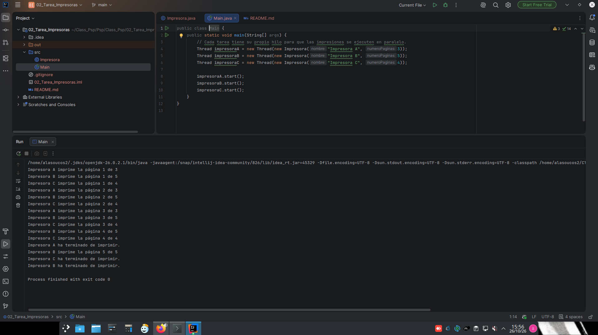

# Tarea 3: Impresoras con Runnable

Simulación de tres impresoras que imprimen en paralelo usando `Runnable` y `Thread`.

## Ejecución

Desde la carpeta `src`, compila y ejecuta el programa con:

```bash
javac Main.java Impresora.java
java Main
```

Se necesita un JDK instalado. Cada impresora tarda un segundo por página y el orden de los mensajes puede variar.

## Captura de la ejecución



## Repositorio

[Ver el proyecto en GitHub](https://github.com/l4nin/Psp/tree/main/Class_Psp/02_Tarea_Impresoras)
